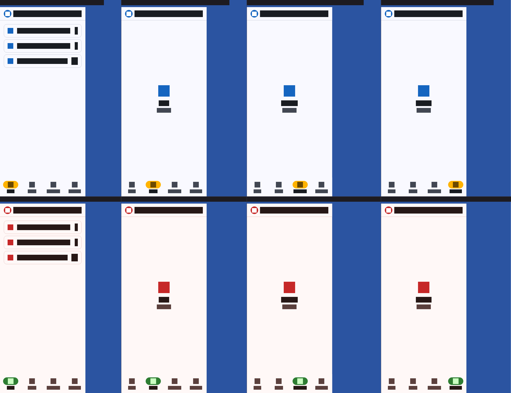

# Tabloide Digital — Painel do Lojista

> Painel do lojista do Tabloide Digital — um único código Flutter para app mobile e web.



*Golden de CI da home mobile, uma coluna por seção (texto renderizado como blocos).*

## Sobre

O painel é onde o lojista acompanha filiais, panfletos e produtos vigentes.

O repositório é um [Pub Workspace](https://dart.dev/tools/pub/workspaces) com três pacotes, e o app raiz (`lib/`) só faz o bootstrap da plataforma certa:

| Pacote | Papel | Depende de |
|---|---|---|
| [`packages/core`](packages/core) (`tabloide_core`) | Identidade (nome e logo), tema, HTTP (Dio), `Either`/`Falha`, controllers e repositórios | — |
| [`packages/app`](packages/app) (`tabloide_app`) | Telas do painel mobile (Android/iOS) | core |
| [`packages/web`](packages/web) (`tabloide_web`) | Telas do painel web | core |

Essas dependências são verificadas por teste (`packages/core/test/arquitetura/dependencias_test.dart`).

## Features

- Home com navegação entre **Início**, **Filiais**, **Panfletos** e **Produtos**.
- Resumo de início com filiais, panfletos vigentes e produtos vigentes.
- URL da API definida no build via `--dart-define`.
- Tema claro único com as cores do Tabloide Digital.

> Os dados do resumo ainda vêm de `HomeRepositoryFake` (em memória); a integração com a API ainda não existe.

## Pré-requisitos

- Flutter com Dart SDK `^3.13.0` (testado com Flutter 3.47.3, canal stable)
- Chrome, para rodar a versão web e os testes de navegador
- Xcode / Android SDK, para rodar no iOS / Android

## Como rodar

```bash
flutter pub get
flutter run -d chrome --dart-define=API_URL=https://tabloide-api.vercel.app/v1
```

Para outro dispositivo, troque o `-d` (ou omita para escolher na hora).

## Configuração

O valor é lido com `String.fromEnvironment` em `lib/main.dart`.

| Variável | Default | Descrição |
|---|---|---|
| `API_URL` | `http://localhost:3000/v1` | URL base da API do Tabloide. |

## Build

```bash
flutter build web --dart-define=API_URL=https://tabloide-api.vercel.app/v1
flutter build apk --dart-define=API_URL=https://tabloide-api.vercel.app/v1
flutter build ios --dart-define=API_URL=https://tabloide-api.vercel.app/v1
```

## Testes

Os scripts ficam no `pubspec.yaml` raiz (seção `melos`) e rodam em todos os pacotes. Não é preciso instalar o Melos globalmente:

```bash
dart run melos run analyze          # flutter analyze em cada pacote
dart run melos run test             # todos os testes, exceto os de navegador
dart run melos run test:golden      # só os goldens
dart run melos run golden:atualizar # regenera os goldens
dart run melos run test:browser     # testes do core no Chrome
flutter test                        # testes da raiz (test/) — o melos não roda esta pasta
```

Só os goldens de `goldens/ci/` vão para o git. Os de plataforma (`macos/`, `linux/`, `windows/`) servem apenas para conferência local.

## Contribuindo

1. Crie uma branch a partir da `main`.
2. Rode `dart run melos run analyze`, `dart run melos run test` e `flutter test` (na raiz) antes de abrir o PR.
3. Se mudou alguma tela, regenere os goldens com `dart run melos run golden:atualizar` e mande as imagens novas no PR.
